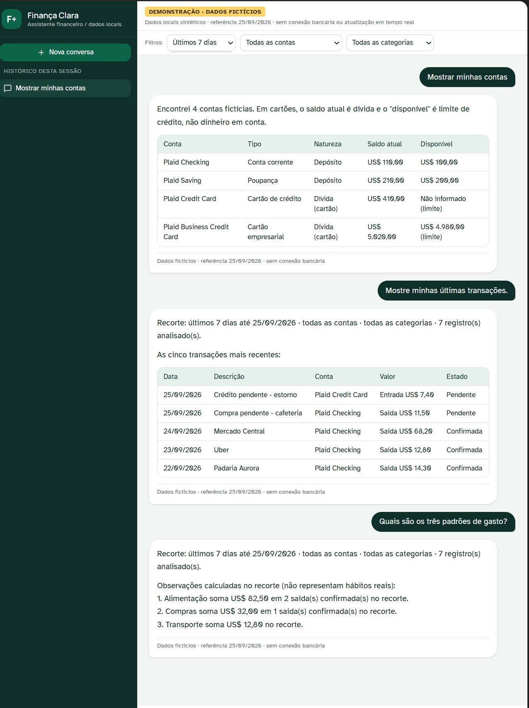

# Evidências visuais — Finança Clara (Etapa 1)

**Aplicativo publicado:** https://financa-clara-mcp.lovable.app/

A captura abaixo registra três interações no chat demonstrativo, com dados **locais, sintéticos e fictícios**, referenciados a **25/09/2026**. Não representa conexão real com instituições financeiras ou uma consulta efetiva às APIs Plaid/Pluggy.

## O que a imagem comprova

1. **Contas:** listagem de quatro contas de exemplo, distinguindo depósitos e dívidas em cartões e mostrando os saldos disponíveis quando informados.
2. **Transações:** tabela das cinco movimentações mais recentes, com data, descrição, conta, valor, direção (entrada/saída) e situação (confirmada/pendente).
3. **Padrões de gastos:** resposta para o filtro de **últimos 7 dias até 25/09/2026**, com sete registros analisados; alimentação de **US$ 82,50** em duas saídas confirmadas, compras de **US$ 32,00** em uma saída e transporte de **US$ 12,80**.

A interface informa explicitamente que se trata de demonstração com dados fictícios. Esta evidência é da **Etapa 1** (dados locais); não substitui testes do MCP da Pluggy nem do Plaid Sandbox no ambiente do desenvolvedor.
